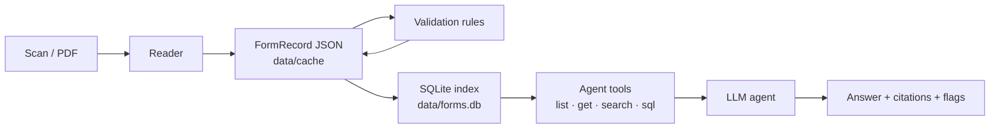

# Design notes

## The problem

The brief asks for an agent that reads forms, extracts structured and unstructured fields, and explains
them through single-form Q&A, summaries, and answers across many forms. It has to work for a **variety of
forms**, not just the sample set.

Three things make this hard:

- **Scans are noisy.** Handwriting, stray marks, skew, and look-alike characters (O/0, I/1) all occur.
  Checkboxes are the classic failure: a smudge reads as a tick.
- **Wrong answers are worse than no answers.** A plausible but invented member ID or NPI is dangerous in a
  medical or admin workflow. The system must say "blank" or "not on the form", and it must show where
  it is unsure.
- **Cross-form questions need exact arithmetic.** "How many urgent requests?" must be counted, not estimated
  by a language model reading a pile of documents.

## Architecture

The stages talk only through one data contract, `FormRecord` (`src/form_agent/schema.py`). Any stage can be
swapped or re-run independently.

### 1. One record shape for every form

`FormRecord.universal` describes any form with four building blocks:

| Block | Example |
|---|---|
| **fields**: label, verbatim value, value type, section, page, `filled` or `printed` | `Member or Medicaid ID #: 62106` |
| **checkbox groups**: every printed option, ticked or not | `Sex: [ ] Male [ ] Female [ ] Other [x] Unknown` |
| **tables**: headers and rows | the *Services Requested* table |
| **text blocks**: free text that isn't a labeled field | a written note, a stamp |

Blank fields are kept, with value `null`. That is how the agent can say *"left blank"* instead of *"not
found"*. Values are verbatim; normalized copies (ISO dates, digit-only phones) are derived from them for
querying.

**Form-type plugins** (`src/form_agent/forms/`) layer a strict typed schema on top for forms we know. The
Texas prior-auth plugin defines the exact fields, the allowed checkbox options, its own validation rules,
and typed SQL tables (`tx_prior_auth`, `tx_services`). A plugin is optional: an unrecognized form keeps the
universal record and everything downstream still works, as the FUNSD results show. Adding a form type means
one file with a pydantic schema and a `detect()` function.

### 2. Readers are swappable

`src/form_agent/readers/` holds a registry (`@register("name")`). Today there are two readers:

- **`openai`**: a vision LLM with structured outputs. Pass 1 extracts the universal record. Then
  `identify()` asks each plugin whether it recognizes the form. If one does, pass 2 fills the typed schema.
- **`hybrid`**: the `openai` output plus local verification (below). It reuses the cached LLM output, so
  verification is free to re-run.

The model is a setting (`OPENAI_MODEL`). `gpt-6-luna` was chosen for cost: ~$0.01 per form. The prompts
force verbatim copying, `null` for blanks, and care with O/0 and I/1. They also ask the model to tag
pre-printed values as `printed`, and to write `[signed]` on signature lines that carry a signature (prompt v4).
Before v4, signed lines came back empty, which made "was this signed?" unanswerable.

### 3. Self-verification (the hybrid reader)

Vision LLMs are good readers but have two systematic failure modes, and both are checkable locally:

- **Checkboxes.** `checkboxes.py` finds every checkbox on the page with OpenCV: hollow square or wide
  rectangular contours of checkbox size (up to 6:1, e.g. "JUNE 30 [  X  ]"), boxes shaded in as the mark, small
  boxes whose tick hides the interior (recognized by four straight inked edges, which letters never have), and
  cells of small box grids. Short blank lines that options are marked on ("_X_ Change", "Personal Service _X_")
  count as boxes too: the space just above the line is measured, and an underscore split by a typed X is
  joined back into one line.
  It measures the ink inside the box's inner outline, so a thick border on a low-res fax doesn't count as a
  tick; for wide boxes it measures the densest box-sized stretch. Each box is labeled from the OCR text on
  its right and on its left, and boxes are matched to the model's checkbox groups with all labels on one side
  (right preferred). Where the ink is decisive (≥10% ticked, ≤6% empty), the pixels
  override the model and a `checkbox_corrected` flag records it. Where it is ambiguous, a
  `checkbox_uncertain` flag goes to a human. On the 11 Texas forms this found exactly 30 boxes per page
  and labeled 330/330 correctly.
- **"Helpful" corrections.** LLMs fix typos, and a transcription must not. `verify.py` re-reads the page
  with RapidOCR and fuzzy-matches each extracted value. A close but different OCR reading produces an
  `ocr_disagrees` flag (e.g. *laparascopy* on the scan vs *laparoscopy* extracted). For codes and IDs, OCR
  confusions such as O/0 are mapped first, so these don't cause false alarms.

### 4. Validation rules

`validate.py` adds review flags; it never changes values.

- **Generic rules**, chosen by value type, apply to any form: NPI length and Luhn check digit, ICD-10 and
  CPT/HCPCS formats, unreadable or implausible dates, impossible birth dates, phone length, and Yes and No
  both ticked.
- **Plugin rules** for the Texas form: required fields, pick-one groups with several ticks, *Urgent*
  without a clinical reason, *Extension* without a previous auth number, end date before start date, and
  services far before or after the request date.

Each flag has a severity (`info`, `warning`, `error`), and the agent mentions flags when they bear on an
answer. `python -m form_agent validate` re-runs the rules on saved records without re-reading anything.

### 5. Storage: JSON is the truth, SQLite is the index

- `data/cache/<doc_id>/<reader>.json` holds one record per form per reader run. This is the source of truth:
  diffable, and easy to compare across readers.
- `data/forms.db` is rebuilt from the JSON in about a second (`python -m form_agent index`). It holds
  generic tables (`fields`, `checkboxes`, `table_cells`, `text_blocks`, `flags`) and `active_*` views. When
  several readers processed a form, the views show the preferred run. It also has an FTS5 full-text index,
  typed tables from plugins, and `form_type_constants`.
- **Tables** are stored one cell per row in `table_cells` (`table_index`, `table_name`, `row_index`,
  `column`, `value`, `value_norm`); the agent reads whole rows with a self-join on the row. `table_name` is the
  printed title or, for untitled tables, the section heading above them ("…headquartered WITHIN the
  region" vs "…OUTSIDE the region"). Readers tidy each table first: a table printed twice side by side
  (same headers repeated) becomes one table, and any other repeated header is numbered ("Code", "Code (2)"),
  so every column can be named in SQL.
- **Template constants.** A printed value that appears on at least half of the forms of a type (and on at
  least 3 forms) is template text, for example the insurer's eight fax and phone numbers. These values are
  marked and listed once, so "what fax number for BH requests?" is answerable but doesn't count as data in
  cross-form statistics. They are matched by value, not label, because the model labels the same printed
  number differently from form to form.

### 6. The agent

`agent.py` runs a tool loop on the OpenAI Responses API. The model gets four read-only tools (`tools.py`):

| Tool | Returns |
|---|---|
| `list_documents(form_type?)` | short ids, titles, flag counts |
| `get_document(doc_id)` | the whole form as text: fields (blanks marked), checkboxes, tables, free text, flags |
| `search(query, doc_id?)` | FTS5 hits across values, labels and free text |
| `sql(query)` | one `SELECT` on a read-only connection; 100-row cap; a runaway-query guard |

The system prompt contains the database schema, generated from the live index. For small value sets it
lists the allowed values (e.g. `general_review_type [Urgent | Non-Urgent]`), so the model writes correct
filters on the first try.

Answer rules: look things up instead of answering from memory, cite every fact as `[short id]`, quote values
verbatim, distinguish *blank* from *absent*, say when a value is pre-printed, and mention flags that affect
the answer.

- **Single-form questions** preload the document, so most need no tool call.
- **Summaries** are one call with a fixed structure: *Summary*, *Key details*, *Needs review*.

**Why tools and SQL instead of putting every form in the prompt:** it scales past the context window, counts
are exact, and every number can be traced to a query. The cost is a few extra round trips (1.8 tool calls
per question on average) and a few cents for the whole test set.

**Safety:** the SQL tool only runs a single `SELECT` or `WITH`, on a SQLite connection opened read-only,
with a step limit. Errors go back to the model as text, so it can fix its query.

**Follow-ups:** `ask(..., history=[(question, answer), ...])` sends earlier turns along. "Which forms are
urgent?" followed by "What are their diagnoses?" works (`python -m form_agent chat`, and the UI).

### 7. Evidence, confidence and human review

These features turn the agent into something a reviewer can trust and correct.

**Where each value is** (`layout.py`). Each scan is OCR'd locally once (small, low-resolution pages also at
2× scale), and the text lines, checkboxes and marked blanks are cached in `data/cache/<doc_id>/_layout.json`.
A value is located by substring match against the OCR lines. The match:
- ignores O/0-style confusions for codes and IDs;
- joins values that wrap onto the next line;
- assembles long values from one block of touching lines, so a phrase that recurs elsewhere on the page
  ("at room temperature") can't pull in other sections;
- for short values like "4", accepts only the occurrence next to the field's label, or, in a table, on the
  same row as the rest of its row;
- confirms a value holding several phone or fax numbers when OCR finds every number;
- lets each OCR region confirm only one value, so two "DATE:" fields can't both lean on the same date.

Checkbox groups are located with the same pixel matcher the hybrid reader uses.

**One form as reviewable items** (`view.py`). The view lists every value as an item: label, value, page
boxes, flags, and an id that says where the value lives in the record (`typed:patient.name`,
`universal:fields.3`). Both the agent and the UI read forms through this view.

**Confidence is about reading, not content.** "Did we transcribe the scan correctly?" is a different question
from "is the form correct?". An NPI can be read perfectly and still fail its check digit. So the two are kept
apart:

| Level | Meaning |
|---|---|
| 🟢 high | local OCR finds the same text, or the checkbox pixels decisively agree |
| 🟡 medium | not confirmed: OCR couldn't find it (handwriting, clipped print) or reads it slightly differently |
| 🔴 low | evidence disagrees: an `ocr_disagrees` or `checkbox_uncertain` flag, or the pixels contradict the ticks |
| 🔵 reviewed | a person confirmed or corrected it |

Content problems stay flags (🛑 ⚠️ ℹ️). On the 11 Texas forms, 565 values are high, 5 medium and 1 low.
The low one is *laparascopy → laparoscopy*, the only extraction error left. Before trusting "medium", check
the scan. One case is "Apt. Texas 83462": text clipped at the top edge of a scan. The model read it
correctly, and OCR couldn't.

**Evidence for an answer.** `evidence_for_answer(view, answer)` finds the form's values that an answer
quotes, including normalized phones, digit strings, and dates in other spellings. The UI then highlights
them on the scan. The model doesn't need to cite field ids for this to work.

**Human review** (`review.py`). A reviewer can correct a value, confirm one, or acknowledge a flag. The result
is a **new record** under the reader name `reviewed`; the machine reading is never modified. The record keeps
a correction log (old → new, who, when). After saving:
- Validation runs again on the new values. For example, unticking *Urgent* removes the "urgent without
  reason" flag.
- Reading flags about reviewed values are dropped, because a person has looked at them.
- For typed forms, the generic record is rebuilt from the typed values, so the cross-form SQL tables agree.

The index prefers `reviewed` over every machine reader, so the agent answers from the corrected values
immediately. In its text view, those values are tagged `{reviewed}`.

**Upload** (`pipeline.py`). `process_file` copies the file into `data/uploads/` under a free id, then reads,
verifies, validates, saves, computes the layout, and re-indexes. The UI's Upload screen calls it, with a
progress message for each step. From the command line, `extract <folder>` does the same for many files.

### 8. Web UI

`app/streamlit_app.py` is a Streamlit app on top of the same modules. It has three screens: *Ask*,
*Forms*, and *Upload* (see the README). It contains no extraction or agent logic of its own; everything it
does is also available from Python and the CLI.

## Creative extensions, summarized

| Extension | Where | Effect |
|---|---|---|
| Pixel checkbox verification | `checkboxes.py`, `verify.py` | checkboxes 2 errors → 0 on the Texas set; corrections are flagged, not silent |
| OCR cross-check | `ocr.py`, `verify.py` | catches the model's "helpful" spelling corrections |
| Review flags | `validate.py`, plugin `validate()` | bad NPIs, codes, dates and contradictions surface in every answer |
| Printed vs filled + template constants | prompt, `store.py` | pre-printed info is answerable without polluting statistics |
| Form-type plugins | `forms/` | strict schemas where known, universal everywhere else |
| Swappable readers | `readers/` | compare models or add a local one without touching the rest |
| Evaluation harness | `evaluate.py`, `qa_eval.py` | every claim in the README is reproducible with one command |
| Values located on the scan + reading confidence | `layout.py`, `view.py` | a reviewer sees what to check; red = the one real error on the Texas set |
| Evidence highlighting | `view.evidence_for_answer`, UI | every answer shows where on the scan its values are |
| Human review with a log | `review.py`, UI | corrections are saved separately with a log, re-validated, and preferred by the agent |
| Upload → ready, follow-up questions | `pipeline.py`, `agent.ask(history=…)` | new forms in one step; conversational Q&A |

## What I'd do next

- **A second opinion on doubtful values.** Read everything with the cheap model, then send only the 🟡 and
  🔴 values, as zoomed crops of the scan, to a stronger model (`gpt-6-sol`). On FUNSD form 87137840,
  `gpt-6-sol` read the handwritten date that `gpt-6-luna` got wrong; most values are 🟢 and would never need
  the second look, so the cost stays close to the cheap model's.
- **A local reader** (e.g. Qwen2.5-VL via Ollama), so the system can run with no API key; the reader
  registry is ready for it.
- **Score the agent on CheckboxQA**, a public benchmark of questions about checkboxes on varied forms. The
  dataset is downloaded to `data/external/checkboxqa`.
- **Use reviews as training signal**: the correction log is a ready-made set of model mistakes for
  prompt tuning or picking a reader.
- **Confidence calibration on FUNSD**: measure how often 🟢, 🟡 and 🔴 values are actually right, using the
  FUNSD labels.
- **Speed.** Reading takes 1–4 minutes per form with `gpt-6-luna` (two passes, high-detail images). Running
  the typed pass from the first pass's output, instead of re-reading the image, would cut it substantially.
