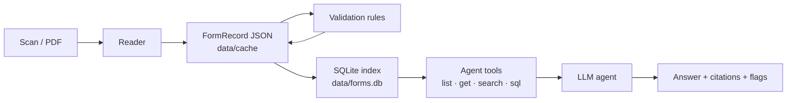

# Design notes

## The problem

The brief asks for an agent that reads forms, extracts structured and unstructured fields, and explains
them through single-form Q&A, summaries, and answers across many forms. It has to work for a **variety of
forms**, not just the sample set.

Three things make this hard:

- **Scans are noisy.** Handwriting, stray marks, skew, and look-alike characters (O/0, I/1) all occur.
  Checkboxes are the classic failure: a smudge reads as a tick.
- **Wrong answers are worse than no answers.** A plausible but invented member ID or NPI is dangerous in a
  medical or admin workflow. The system must say "blank" or "not on the form", and it must show where
  it is unsure.
- **Cross-form questions need exact arithmetic.** "How many urgent requests?" must be counted, not estimated
  by a language model reading a pile of documents.

## Architecture

The stages talk only through one data contract, `FormRecord` (`src/form_agent/schema.py`). Any stage can be
swapped or re-run independently.

### 1. One record shape for every form

`FormRecord.universal` describes any form with four building blocks:

| Block | Example |
|---|---|
| **fields**: label, verbatim value, value type, section, page, `filled` or `printed` | `Member or Medicaid ID #: 62106` |
| **checkbox groups**: every printed option, ticked or not | `Sex: [ ] Male [ ] Female [ ] Other [x] Unknown` |
| **tables**: headers and rows | the *Services Requested* table |
| **text blocks**: free text that isn't a labeled field | a written note, a stamp |

Blank fields are kept, with value `null`. That is how the agent can say *"left blank"* instead of *"not
found"*. Values are verbatim; normalized copies (ISO dates, digit-only phones) are derived from them for
querying.

**Form-type plugins** (`src/form_agent/forms/`) layer a strict typed schema on top for forms we know. The
Texas prior-auth plugin defines the exact fields, the allowed checkbox options, its own validation rules,
and typed SQL tables (`tx_prior_auth`, `tx_services`). A plugin is optional: an unrecognized form keeps the
universal record and everything downstream still works, as the FUNSD results show. Adding a form type means
one file with a pydantic schema and a `detect()` function.

### 2. Readers are swappable

`src/form_agent/readers/` holds a registry (`@register("name")`). Today there are two readers:

- **`openai`**: a vision LLM with structured outputs. Pass 1 extracts the universal record. Then
  `identify()` asks each plugin whether it recognizes the form. If one does, pass 2 fills the typed schema.
- **`hybrid`**: the `openai` output plus local verification (below). It reuses the cached LLM output, so
  verification is free to re-run.

The model is a setting (`OPENAI_MODEL`). `gpt-6-luna` was chosen for cost: ~$0.01 per form. The prompts
force verbatim copying, `null` for blanks, and care with O/0 and I/1. They also ask the model to tag
pre-printed values as `printed`.

### 3. Self-verification (the hybrid reader)

Vision LLMs are good readers but have two systematic failure modes, and both are checkable locally:

- **Checkboxes.** `checkboxes.py` finds every square box on the page with OpenCV (hollow contours of
  checkbox size and shape) and measures the ink inside. Each box is labeled from nearby OCR text, and boxes
  are matched to the model's checkbox groups. Where the ink is decisive (≥10% ticked, ≤6% empty), the pixels
  override the model and a `checkbox_corrected` flag records it. Where it is ambiguous, a
  `checkbox_uncertain` flag goes to a human. On the 11 Texas forms this found exactly 30 boxes per page
  and labeled 330/330 correctly.
- **"Helpful" corrections.** LLMs fix typos, and a transcription must not. `verify.py` re-reads the page
  with RapidOCR and fuzzy-matches each extracted value. A close but different OCR reading produces an
  `ocr_disagrees` flag (e.g. *laparascopy* on the scan vs *laparoscopy* extracted). For codes and IDs, OCR
  confusions such as O/0 are mapped first, so these don't cause false alarms.

### 4. Validation rules

`validate.py` adds review flags; it never changes values.

- **Generic rules**, chosen by value type, apply to any form: NPI length and Luhn check digit, ICD-10 and
  CPT/HCPCS formats, unreadable or implausible dates, impossible birth dates, phone length, and Yes and No
  both ticked.
- **Plugin rules** for the Texas form: required fields, pick-one groups with several ticks, *Urgent*
  without a clinical reason, *Extension* without a previous auth number, end date before start date, and
  services far before or after the request date.

Each flag has a severity (`info`, `warning`, `error`), and the agent mentions flags when they bear on an
answer. `python -m form_agent validate` re-runs the rules on saved records without re-reading anything.

### 5. Storage: JSON is the truth, SQLite is the index

- `data/cache/<doc_id>/<reader>.json` holds one record per form per reader run. This is the source of truth:
  diffable, and easy to compare across readers.
- `data/forms.db` is rebuilt from the JSON in about a second (`python -m form_agent index`). It holds
  generic tables (`fields`, `checkboxes`, `table_cells`, `text_blocks`, `flags`) and `active_*` views. When
  several readers processed a form, the views show the preferred run. It also has an FTS5 full-text index,
  typed tables from plugins, and `form_type_constants`.
- **Template constants.** A printed value that appears on at least half of the forms of a type (and on at
  least 3 forms) is template text, for example the insurer's eight fax and phone numbers. These values are
  marked and listed once, so "what fax number for BH requests?" is answerable but doesn't count as data in
  cross-form statistics. They are matched by value, not label, because the model labels the same printed
  number differently from form to form.

### 6. The agent

`agent.py` runs a tool loop on the OpenAI Responses API. The model gets four read-only tools (`tools.py`):

| Tool | Returns |
|---|---|
| `list_documents(form_type?)` | short ids, titles, flag counts |
| `get_document(doc_id)` | the whole form as text: fields (blanks marked), checkboxes, tables, free text, flags |
| `search(query, doc_id?)` | FTS5 hits across values, labels and free text |
| `sql(query)` | one `SELECT` on a read-only connection; 100-row cap; a runaway-query guard |

The system prompt contains the database schema, generated from the live index. For small value sets it
lists the allowed values (e.g. `general_review_type [Urgent | Non-Urgent]`), so the model writes correct
filters on the first try.

Answer rules: look things up instead of answering from memory, cite every fact as `[short id]`, quote values
verbatim, distinguish *blank* from *absent*, say when a value is pre-printed, and mention flags that affect
the answer.

- **Single-form questions** preload the document, so most need no tool call.
- **Summaries** are one call with a fixed structure: *Summary*, *Key details*, *Needs review*.

**Why tools and SQL instead of putting every form in the prompt:** it scales past the context window, counts
are exact, and every number can be traced to a query. The cost is a few extra round trips (1.8 tool calls
per question on average) and a few cents for the whole test set.

**Safety:** the SQL tool only runs a single `SELECT` or `WITH`, on a SQLite connection opened read-only,
with a step limit. Errors go back to the model as text, so it can fix its query.

## Creative extensions, summarized

| Extension | Where | Effect |
|---|---|---|
| Pixel checkbox verification | `checkboxes.py`, `verify.py` | checkboxes 2 errors → 0 on the Texas set; corrections are flagged, not silent |
| OCR cross-check | `ocr.py`, `verify.py` | catches the model's "helpful" spelling corrections |
| Review flags | `validate.py`, plugin `validate()` | bad NPIs, codes, dates and contradictions surface in every answer |
| Printed vs filled + template constants | prompt, `store.py` | pre-printed info is answerable without polluting statistics |
| Form-type plugins | `forms/` | strict schemas where known, universal everywhere else |
| Swappable readers | `readers/` | compare models or add a local one without touching the rest |
| Evaluation harness | `evaluate.py`, `qa_eval.py` | every claim in the README is reproducible with one command |

## What I'd do next

- **A local reader** (e.g. Qwen2.5-VL via Ollama), so the system can run with no API key; the reader
  registry is ready for it.
- **Score the agent on CheckboxQA**, a public benchmark of questions about checkboxes on varied forms. The
  dataset is downloaded to `data/external/checkboxqa`.
- **Bounding boxes for every value,** so the UI can highlight where an answer came from. The OCR layer
  already has them; it needs a matching step.
- **A small UI** (upload a form, chat with it, click a citation to see the scan).
- **Speed.** Reading takes 1–4 minutes per form with `gpt-6-luna` (two passes, high-detail images). Running
  the typed pass from the first pass's output, instead of re-reading the image, would cut it substantially.
